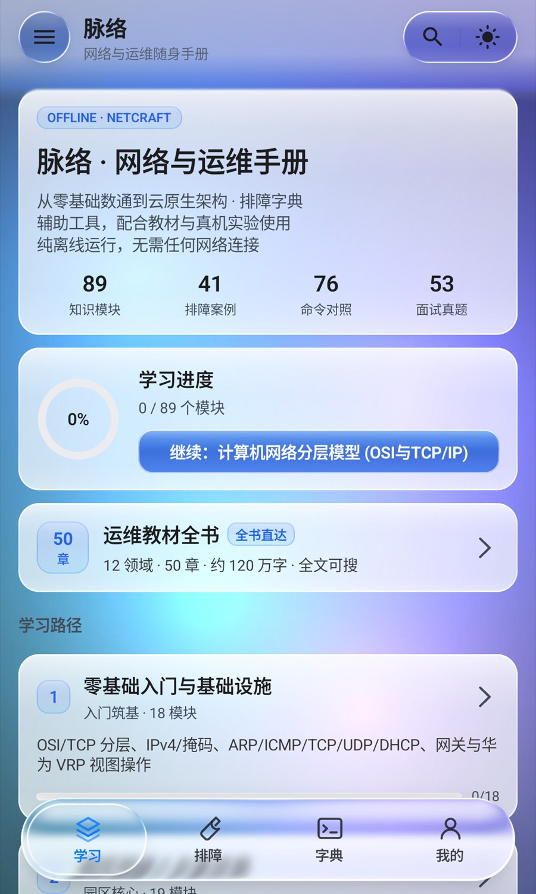
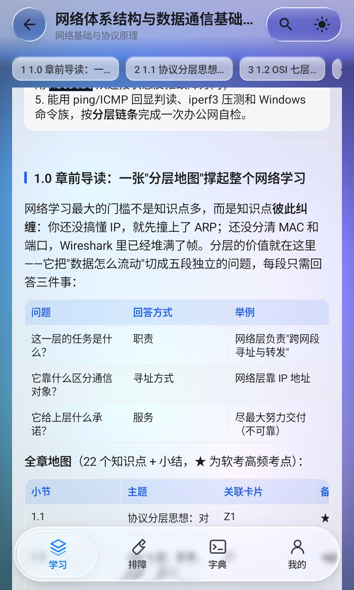
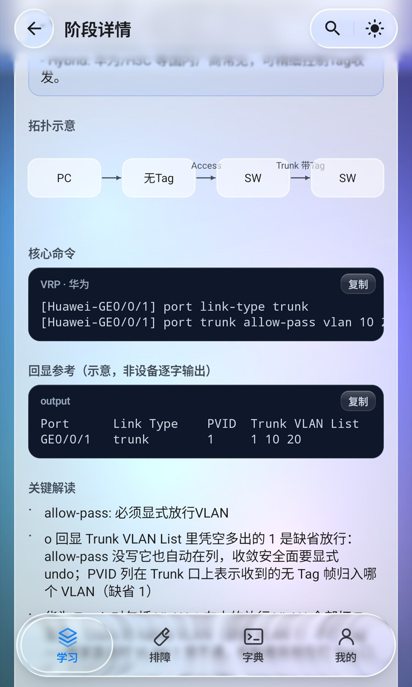
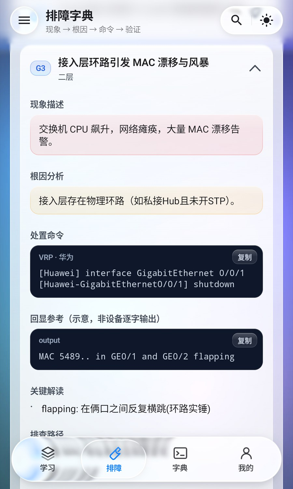
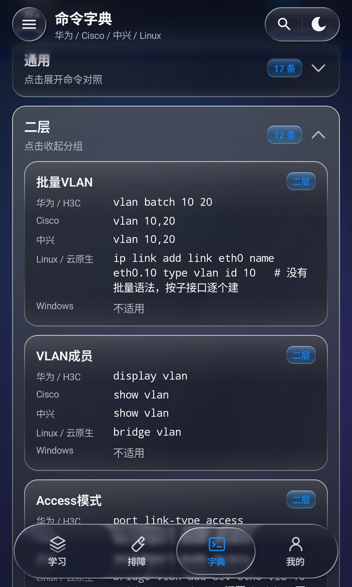
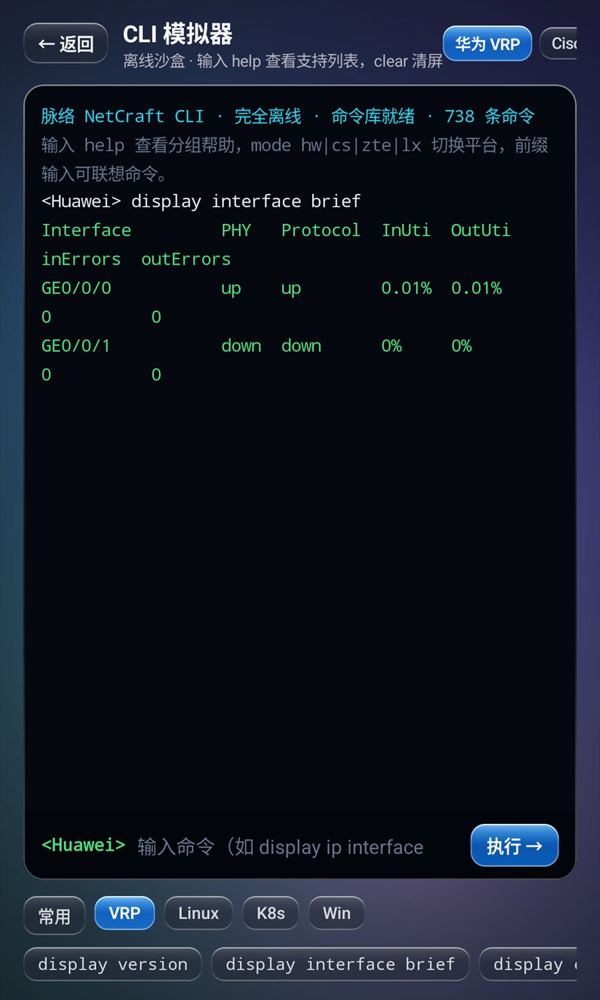
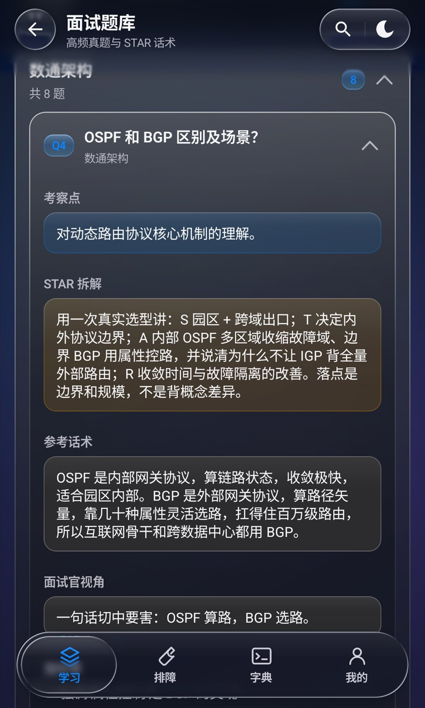
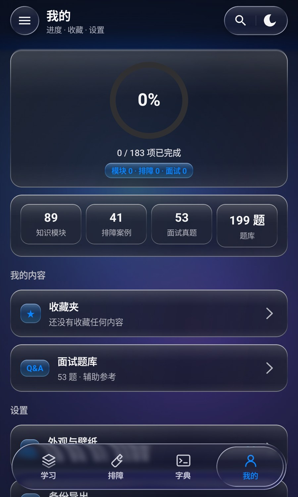
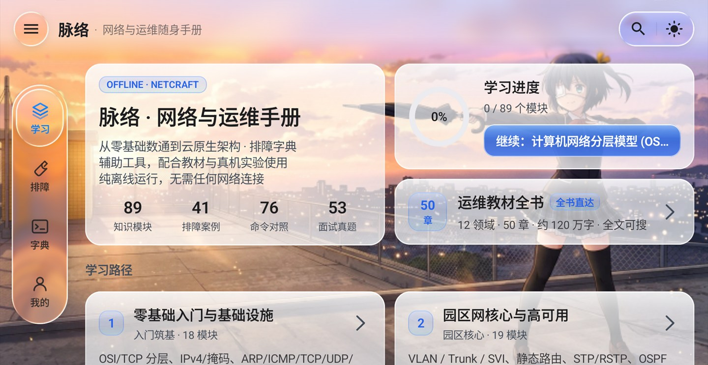
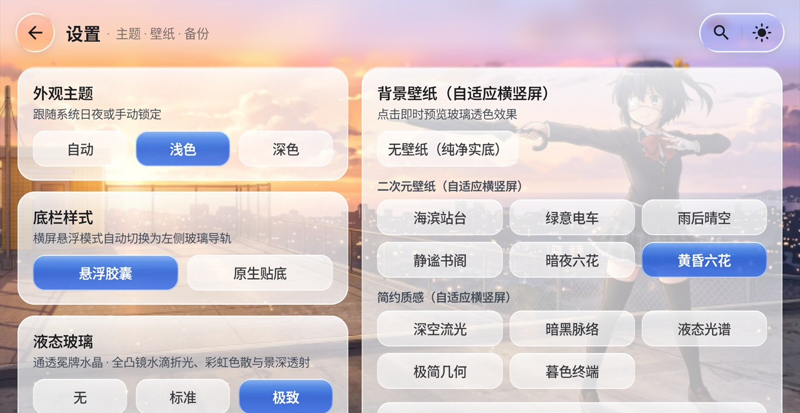

# 脉络 · NetCraft

**离线网络工程与运维随身手册**

> 从零基础数通到云原生架构，把完整的网络与系统运维知识体系装进口袋随身查。**完全离线，零权限声明，无需任何网络连接。**
>
> **12 大领域 50 章（约 120 万字）运维教材全书** + 89 个知识模块、41 个排障案例、76 条多厂商命令对照、738 条 CLI 模拟器命令、53 道面试真题、199 道测验题 ——
> 全装在一个安装包里，打开即用，不联网、不注册、不看广告。
>
> 先说清楚定位：它是**辅助工具**，得配着教材、网课和真机实验一起用，不是一门能独立走完的课。

[](https://github.com/7SteveJohn/netops-handbook/releases/tag/v2.1.0)
[](#)
[](#)
[](https://github.com/7SteveJohn/netops-handbook/releases/tag/v2.1.0)

---

## 它是什么

**脉络 · NetCraft**（原名 NetOps Handbook）是一个为零基础学习者与一线网络/系统运维工程师打造的 **Android 原生离线网络工程与运维随身手册 App**，采用全新 **Jetpack Compose + 液态玻璃（Liquid Glass）** 光学交互设计。

所有内容——**50 章 120 万字运维教材全书**、知识模块、排障案例、五平台命令字典、面试题库、CLI 模拟器、22 张内置横竖屏成对壁纸——全部离线封装在安装包内，装机即用，机房断网也能秒查。

适合这些场景：

- 🏗 机房割接现场，没网也能秒查多厂商命令与排障步骤
- 📘 通勤与自习时系统精读 50 章网络与 Linux 运维讲义，断点续读
- 📝 面试突击复习，随时翻阅 STAR 话术拆解与 199 道自测题
- 📖 上课学网络时当随身字典，全局秒搜协议原理、命令与教材段落
- 🔧 现场排障速查，对照「现象 → 根因 → 排查命令」快速定位故障

不适合：指望只翻它就把网络学会。系统掌握工程能力还得靠真机实验与现场实践。

## 核心亮点

- **📘 120 万字「运维教材全书」离线随包**：12 大领域、50 章、1,003 个二级小节，支持 H2 小节快跳、断点续读与毫秒级全文倒排秒搜直达段落
- **💎 液态玻璃（Liquid Glass）三档光学交互**：支持 **极致（通透冕牌水晶 + 活体水珠折射色散）/ 标准（温润云母磨砂护眼）/ 无（纯平省电）** 三档即时切换，以及 **悬浮水晶胶囊 / 清爽无药丸原生贴底** 双态底栏
- **🖼️ 横竖屏双套壁纸随旋转无缝切换**：内置 **11 套（共 22 张）横竖屏成对壁纸**（二次元 6 套 + 简约质感 5 套）及相册自选壁纸，旋转屏幕自动切换对应比例的横图 / 竖图，拒绝硬拉伸与主体裁切
- **📱 手机与平板横屏全链路重构**：紧凑横屏自动切换 **`48dp` 渐进模糊顶栏 + 左侧竖排液态水晶导轨 + 双列/分栏宽屏卡片网格**，完整避让挖孔屏与手势安全区

## 界面一览

<table>
  <tr>
    <td align="center" width="25%">
      <br />
      <sub><b>首页</b> — 液态水晶底栏、学习进度与教材全书直达</sub>
    </td>
    <td align="center" width="25%">
      <br />
      <sub><b>运维教材全书</b> — 12 领域 50 章 · 120 万字讲义与小节快跳</sub>
    </td>
    <td align="center" width="25%">
      <br />
      <sub><b>知识模块</b> — 原理正文 + 拓扑示意 + 多厂商命令与实验</sub>
    </td>
    <td align="center" width="25%">
      <br />
      <sub><b>排障案例</b> — 41 个现场故障「现象 → 分析 → 命令」</sub>
    </td>
  </tr>
  <tr>
    <td align="center" width="25%">
      <br />
      <sub><b>命令字典</b> — 华为 / Cisco / 中兴 / Linux / Windows 对照</sub>
    </td>
    <td align="center" width="25%">
      <br />
      <sub><b>CLI 模拟器</b> — 六平台离线沙盒，738 条命令真实回显</sub>
    </td>
    <td align="center" width="25%">
      <br />
      <sub><b>面试真题</b> — 53 题全量附考察点、STAR 拆解与参考话术</sub>
    </td>
    <td align="center" width="25%">
      <br />
      <sub><b>我的</b> — 进度环、分项统计、三档液态玻璃与备份恢复</sub>
    </td>
  </tr>
</table>

### 横屏适配与双套壁纸自动切换实机效果

<table>
  <tr>
    <td align="center" width="50%">
      <br />
      <sub><b>横屏首页</b> — 48dp 紧凑顶栏 + 左侧竖排液态水晶导轨 + 双列卡片 + 16:9 横屏壁纸自动切换</sub>
    </td>
    <td align="center" width="50%">
      <br />
      <sub><b>横屏设置双栏</b> — 左侧三档液态玻璃/底栏控制 + 右侧 11 套横竖屏自适应壁纸网格</sub>
    </td>
  </tr>
</table>

## 核心板块

### 📘 运维教材全书 — 12 领域 · 50 章 · 约 120 万字

体系化覆盖从底层通信原理到云原生 SRE 的完整工程讲义，离线随包秒开：

- **12 大技术领域、50 章深度正文**（1,003 个二级小节、25,059 个结构化内容块）：涵盖网络基础与协议、园区网与无线、路由与数据中心（OSPF/IS-IS/BGP/VXLAN/EVPN）、广域网与 VPN、安全与 QoS、虚拟化与 Kubernetes 容器网络、Linux 服务器与数据库运维（8 章）、监控与自动化运维、备份容灾与割接管理、机房综合布线、端到端排障方法论及跨厂商命令矩阵
- **丝滑章节阅读器**：顶部 H2 小节冰晶胶囊快跳条、自适应宽表横向浏览、围栏命令块高亮、上下章无缝切换与「上次读到」断点续读
- **全书毫秒级检索**：内置中文 2-gram + 拉丁词倒排索引，右上角全局搜索输入任意协议或命令，一键空降对应章节段落

### 📚 学习 — 89 个知识模块

按四阶段组织的速查与带练卡片路径：

1. **零基础入门与基础设施**（18 模块）— OSI/TCP 分层、IPv4/掩码与网关、ARP、ICMP 与 ping/tracert、TCP/UDP、DHCP、DNS、NTP、抓包（tcpdump/Wireshark）、iperf3、Windows 分层排障、华为 VRP 视图与开局实验
2. **园区网核心与高可用**（19 模块）— 静态路由与最长匹配、VLAN / Trunk / SVI、STP / RSTP / MSTP、OSPF 多区域与 LSA、IS-IS、BGP 属性选路、VRRP / iStack / M-LAG / Eth-Trunk、组播 IGMP/PIM、QoS
3. **广域网、安全、无线与 NetDevOps**（22 模块）— NAT / PPPoE / MPLS L3VPN / SD-WAN、ACL 与防火墙 Zone、IPsec / SSL VPN / MACsec、802.1X 准入、无线 AC-AP 与 802.11r 漫游、Netmiko / Ansible / GitOps
4. **云原生与高级前沿**（30 模块）— VXLAN / EVPN、IPv6、BGP unnumbered、SNMP / NetFlow / gNMI 流式遥测、Prometheus / Zabbix / Syslog、K8s CNI / Calico / NetworkPolicy / Gateway API / CoreDNS、eBPF、混沌工程、SLI / SLO

每个模块均含原理机制、网络拓扑、多厂商配置、分步操作路径与避坑提示，支持一键收藏与掌握进度标记。

### 🔧 排障 — 41 个真实场景

典型故障的「现象 → 分析 → 命令」三段式卡片：

- 链路不通怎么排查？从物理层光衰、双工错配到路由表逐层定位
- 隧道 MSS 导致大包丢包？`tcp adjust-mss` 一行搞定
- STP 风暴 / MAC 漂移 / OSPF 卡 ExStart / M-LAG 脑裂 / Docker 网段冲突……每项均附现象判据与急救命令

### 📖 字典 — 76 条多厂商命令对照

同一功能，**华为 / Cisco / 中兴 / Linux / Windows** 五平台命令并排对照、支持按分类筛选与单格一键复制：

```
示例：Trunk 放行 VLAN
  华为: port trunk allow-pass vlan 10
  Cisco: switchport trunk allowed vlan 10
  中兴: port trunk permit vlan 10
  Linux: bridge vlan add vid 10 dev eth0
```

### 💻 CLI 终端模拟器 — 738 条命令

内置离线终端模拟器，贴近真实设备操作体验：

- **738 条命令**：华为 VRP / Cisco IOS / 中兴 / Linux / K8s / Windows 六平台
- **智能匹配**：精确匹配 → 前缀联想 → 模糊近似建议；输入 `display` 自动列出全部 `display` 开头的命令
- **分组帮助**：`help` 按平台/功能分组展示常用命令示例
- **历史持久化**：命令历史存本地，上下翻看，重开 App 自动恢复
- **平台切换**：随时切换设备类型，终端提示符跟随变化

### 📝 面试 — 53 道真题

从基础协议辨析到大型网络架构设计题全覆盖：

- 「Hybrid 接口和 Access / Trunk 的区别？」
- 「OSPF 的 LSA 类型有哪些？Type 7 是什么？」
- 「iptables 规则多了性能会怎样？是 O(n) 还是指数级？」
- 「公有云里 Calico 为什么不能直接跑 BGP？」

全部 53 道真题均配备**考察点、STAR 拆解（S/T/A/R）与参考话术**，并支持按目标岗位（数通 / 云原生 / SRE / 安全 / 自动化）智能排序与关联卡片回看。

### 👤 我的与个性化外观

- **总进度圆环与四格统计**：实时追踪知识模块、排障案例、面试真题掌握度
- **模拟测验（199 题）与错题本闭环**：随机抽题判分、记录连击；错题自动归集并带锚点一键跳回原知识卡，重练答对自动移出
- **随身工具箱**：速查表（14 张高频对照表）、术语词典（58 条）、子网/掩码计算与学习路线图
- **三档液态玻璃（Liquid Glass）**：
  - **极致**：通透冕牌水晶 + 活体凸透镜水滴折射、彩虹色散与无壁纸空间极光微晕
  - **标准**：温润云母柔雾磨砂 + 内敛气垫微弹，适合长时间专注阅读且功耗均衡
  - **无**：纯平实底极简模式，零着色器开销最省电
- **双态导航与横屏自适应**：「悬浮胶囊 / 原生贴底」一键切换；横屏自动切换为左侧竖排液态水晶导轨 + 双列宽屏卡片网格
- **22 张自适应壁纸 + 相册自选**：内置二次元 6 套 + 简约质感 5 套（横竖屏成对随旋转自动切换），支持相册选图与 JSON 全量进度备份导出/恢复

## 使用方式

1. **下载安装** → 前往 [Releases 页面](https://github.com/7SteveJohn/netops-handbook/releases/tag/v2.1.0) 下载正式签名包 `NetCraft-v2.1.0.apk`，直接安装即可（旧版 NetOps 用户可直接覆盖安装升级，进度与收藏完整保留）
2. **打开即用** → 底部四个 Tab 切换：**学习 / 排障 / 字典 / 我的**；首页首屏可直接进入 **「运维教材全书」**
3. **全局检索** → 右上角灵动水滴胶囊点 🔍 秒搜全站知识卡、命令与 120 万字教材段落
4. **明暗切换** → 右上角双格胶囊点 ☀️ / 🌙（或横滑水珠）实时切换深浅色主题
5. **侧滑目录** → 左上角 ☰ 呼出空间毛玻璃抽屉快速跳转任意阶段与工具

> **隐私说明**：本应用**不申请任何系统权限**——无联网权限、无存储权限、无广告 SDK、无后台服务。首次安装时系统提示「未知来源」属正常现象，确认安装即可。

## 内容一览

| 类别 | 数量 | 示例 |
|------|------|------|
| 运维教材全书 | 50 章（约 120 万字） | 12 大领域 · 1,003 个二级小节，从 OSI/路由交换/防火墙到 K8s/Linux 运维/SRE 全景讲义 |
| 知识模块 | 89 | OSI 分层、ARP/ICMP/TCP/DHCP、静态路由、VLAN/Trunk、STP/RSTP、OSPF/IS-IS/BGP、VXLAN/EVPN、gNMI 遥测、eBPF、GitOps… |
| 排障案例 | 41 | 链路不通、MSS 过小丢包、STP 风暴、MAC 漂移、OSPF 邻居异常、M-LAG 脑裂、Docker 网段冲突… |
| 命令对照 | 76 | 华为 / Cisco / 中兴 / Linux / Windows 五平台横向对照（Trunk 放行、OSPF/BGP 巡检、接口状态等） |
| CLI 模拟器 | 738 条命令 | 六平台离线终端沙盒，支持前缀补全、模糊建议与历史记录持久化 |
| 面试真题 | 53 | Hybrid vs Trunk、LSA 类型、iptables 复杂度、Calico 云端限制…（100% 含考察点与 STAR 拆解） |
| 模拟测验 | 199 题 | 按阶段抽 10 题自动判分，全量绑定知识卡锚点与错题本闭环复习 |
| 速查表 | 14 张 | 子网掩码、常见端口、协议号、生成树、抓包过滤器、EVPN 路由类型等高频速查表 |
| 术语词典 | 58 条 | 核心网络与云原生运维术语定义与易混概念辨析 |

## 技术架构

- **Jetpack Compose 全原生 UI + AGSL 实时光学着色器**：顶栏、悬浮胶囊/贴底双态底栏、侧边抽屉与全部 13 个功能页面均由原生 Compose 驱动；壳层采用 `LayerBackdrop` 同帧采样与凸透镜色散折射着色器，滚动列表微组件采用单遍 `drawWithCache` 零离屏缓冲架构保障 120Hz 满帧顺滑
- **高性能离线检索引擎**：120 万字教材采用后台 IO 预热 + 原始整型数组倒排索引（检索延迟 `< 0.3ms`），章节正文采用异步流式预解析与 LRU 缓存
- **五道自动化构建门禁**：离线零外链门禁、玻璃覆盖门禁、内容与统计一致性门禁、44 组壁纸明暗 WCAG 对比度门禁、JS-Native 桥面零死桥门禁
- **开源协议**：仅供学习交流 · 禁止商用（见 [LICENSE](./LICENSE)）

## 更新日志

> 对外版本号固定 **2.1.0**（2026-11-11 起）：`versionName` 不再随交付递增，
> 内部 `versionCode` 用于覆盖安装识别新旧包。

### v2.1.0 · 品牌焕新「脉络 · NetCraft」+ 120 万字教材全书 + 全 Compose 液态玻璃终版（2026-11-18，code 16）

- **正式更名「脉络 · NetCraft」**：告别易造成误解的 `2.0` 后缀，桌面短名焕新为 **「脉络」**（保持 `com.netops.handbook` 包名兼容，旧版用户可直接覆盖升级不丢进度）
- **120 万字「运维教材全书」离线随包**：新增 12 大领域、50 章、1,003 小节体系化教材，首页首屏直达卡片 + H2 冰晶胶囊快跳条 + 断点续读 + 全局倒排秒搜直达小节
- **全站 Jetpack Compose 化与液态玻璃（Liquid Glass）打磨**：
  - 底部 Dock 与横屏侧边导轨升级高折射率冕牌水晶光学（常驻边缘折光、钻石切边高光、按压磨砂动态消融化作 `1.37x` 纯水凸透镜大水滴，保留清爽无药丸「原生贴底」双态切换）
  - 顶栏左上圆钮与右上搜索/主题双格胶囊接入活体水珠物理引擎（极速轻点冲顶膨胀门控、`tanh` 表面张力牵引、跨格滑行水珠与 `☀️ ↔ 🌙` 180° 弹性旋转）
  - 拉开 **「无 / 标准（温润云母磨砂）/ 极致（通透冕牌水晶）」** 三档全链路透光率、模糊度与回弹张力层级（无壁纸模式下「极致」档自带空间极光微晕）
- **手机与平板横屏全面适配 & 横竖屏双套壁纸无缝切换**：
  - 紧凑横屏自动启用 `48dp` 渐进模糊顶栏 + 左侧竖排液态水晶导轨 + 双列卡片/分栏布局，适配挖孔屏安全区零遮挡；
  - 11 套内置壁纸（共 22 张横竖屏成对原图）随屏幕旋转自动无缝切换对应比例，彻底告别横屏拉伸与人物裁切

### 2.1.0 修订 · 运维教材全书接入（2026-11-18）

> 全书 12 领域 · 50 章 · 约 120 万字教材级内容离线随包（code 14），
> 抽屉入口 + 全局搜索全文命中；APK 6.8 → 12.0MB（教材压缩增量 +5.2MB）。

- **书架**：抽屉「页面」段新增「运维教材全书」——12 领域 → 50 章卡
  （编号 / 小节数 / 字数），「上次读到」一键续读
- **章节阅读**：H2 小节快跳条、五段式正文（定义 → 原理 → 参数命令 →
  实例 → 排错 → 坑 → 考点）、GFM 表格横向滚动、围栏命令块、上一章/下一章
- **全文检索**：全局搜索新增「教材全书」命中段（小节粒度、书序 30 条），
  命中卡直达对应小节；中文 2-gram + 拉丁词倒排索引随包内嵌
- 纯新增：现有页面/渲染器零改动（OpsBlocks 等一行未动）

### 2.1.0 修订 · 切页跟手（2026-11-11）

> 真机实测（`dumpsys gfxinfo`，5 轮往返切页）：**95th 57→20ms、99th 200→30ms、
> jank 6.7%→1.34%**。液态玻璃与实时透出效果不变（滚动前后 dock 区亮度 144→226，与改前同量级）。

- **切页后不再强制同步录屏**：原逻辑在切页 700ms 时把抓图成本清零、逼回同步 `anchor.draw`，
  而新页刚可见时同步录制要重建整棵视图树的显示列表（实测 187~192ms）—— 就是「切完卡一下」
- **PixelCopy 发起挪到后台线程**：在 UI 线程发起要等一次合成排队
- **字典页缓存视图**：原先每次进入都重建 76 行、退出即销毁，改为脏标记按需重建

### 2.1.0 修订 · 主题单源 + 切主题闪退修复（2026-11-11）

- **主题模式单源**：模式（跟随系统/浅色/深色）只存原生，网页经桥回读 → 修「切深色退出重进变浅色」
- **切主题闪退**：透镜层回收实时位图前先摘除引用它的 shader（`BitmapShader` 惰性建 native，下一次绘制才崩）
- **顶栏主题图标**：改由主题总线广播驱动，不再跟随网页滞后状态 → 修「按钮一直是太阳」

### v2.1.0 · 知识库大扩容 + 原生化收口 + 外观个性化 + 全量审计勘误

> 本轮核心：知识体系从「入门手册」补齐为「全阶段带练手册」——68→89 个知识模块、
> 排障 35→41、面试 53 题全面强化、题库 72→199 反作弊平衡；随后完成壳层原生化
> 与外观个性化（玻璃三档、底栏双态、切页淡化），并以 199 题全量人工审计收口。
> 同版本线内分阶段交付（内部 versionCode 递增），对外统一发布 2.1.0。

- **知识模块 68→89**：新增抓包（tcpdump/Wireshark）、DNS 递归与缓存、iperf3 测速、NTP 与时钟失步、Windows 终端分层排障、QoS 整形与监管、IS-IS、组播 IGMP/PIM、M-LAG、MACsec、SD-WAN、SSL VPN、行为管理、gNMI 流式遥测、NetFlow/sFlow、SNMP Trap、Zabbix 对接、BGP unnumbered 等 21 讲；每讲含原理、多厂商命令、回显参考、分步实验与避坑
- **排障矩阵 35→41**：新增组播泛洪、M-LAG 脑裂、MACsec 不通、SSL VPN 应用断流、Docker 网段冲突、行为管理识别盲区等 6 个高频现场故障
- **面试攻防 53 题全面强化**：16 题补齐雷区、「常见追问」栏从岗位标签全部换成可作答的真实追问；全部带考察点、STAR 拆解与参考话术
- **题库 72→199**：89 个学习模块全部有题目锚点（错题本可跳回原卡）；答案位置四选项精确均衡（50/50/50/49），「背位置」「挑最长」无从下手
- **多厂商字典 58→76 行**：新增 Windows 平台列（五家平台横向对照）
- **CLI 模拟器 431→738 条**：规则收口到 22-cli-rules.js，构建期可复算
- **壁纸体系重构**：14→22 张（二次元 6 套 + 简约 5 套 × 横竖屏），全部按屏幕方向成对提供、随旋转自动切换；资产去角色化命名（anime_*/min_*）
- **新增速查**：抓包过滤器（BPF 抓前筛 vs 显示过滤器抓后筛）、Windows 网络排障命令分层速查

**2.1.0 后续修订（内部里程碑，不单独发版；对外始终是 2.1.0）**

> GitHub 上一次发布的包是 **v2.0.5**，本轮是整体重构，版本号只向上走一格到 **2.1.0**；
> 之后的修订不再改版本号，靠 `dist/` 日期区分。

- **切页跟手（2026-11-11）**：dock 实时抓图不再卡主线程——拆掉切页 700ms 处的「强制同步录制」（新页刚可见时同步 `anchor.draw` 要重建整棵显示列表，实测 187~192ms），改为切页后 1.5s 异步窗口 + PixelCopy 发起移到后台线程；字典页视图缓存按需重建。真机 5 轮往返：95th 57→20ms、99th 200→30ms、jank 6.7%→1.34%
- **主题单源 + 闪退修复（2026-11-10）**：主题模式只存原生（网页经桥回读），修「切深色退出重进变浅色」；透镜层回收实时位图前先摘除引用它的 shader，修切主题闪退；顶栏主题图标改由主题总线广播驱动
- **壳层原生化收口**：dock/顶栏/背景全部原生接管——dock 玻璃单窗口拓扑收拢、backdrop 显示收口（修复抽屉手势「交互丢失」）、letterbox 统一模糊；深色模式真源统一四连修；设置面板下线 HTML 玻璃时代失效区块，smoke 回归 115 条全绿
- **切页淡化 + 性能**：页面切换从 1 帧硬切改为 160ms 快照交叉淡化；排障页分组折叠，首建 197ms → 4-7ms；未挂载的 Compose 实验 UI 移出编译，APK 减重 480KB
- **外观个性化**：底栏悬浮胶囊 ⇄ 原生贴底双态（贴底按 Material 3 NavigationBar 语义）；液态玻璃无/标准/极致三档；顶/底栏玻璃跟手修复集（按住冻结、设置桥断喂、转场闸门）；「从相册选取」自定义壁纸入口回归
- **知识全量审计勘误**：机器完整性校验 + 人工通读全部 199 题、58 术语、76 字典行；修复 1 处事实错误（IS-IS 优先级 18→华为 VRP 缺省 15，排序链补全 OSPF 10 < IS-IS 15 < 静态 60 < OSPF ASE 150）；字典分类正则缺陷致 10 行错位归位（「无线」类只剩 AP 状态与无线 SSID 2 条）；数据健康基线——答案分布 50/50/50/49、无重复题干、零空值

### v2.0.5 · 返回键稳态 + 搜索交互收拢 + 构建水印

> 本轮核心：Android 返回链路三处竞态/错挂修复、搜索栏 ✕ 退场与搜索态三路收拢、
> 装机构建水印、smoke 回归扩至 95 条全绿。

**返回键稳态（Android 壳）**
- `enableOnBackInvokedCallback` 此前误挂在 `<activity>` 上被系统整体忽略，App 一直跑旧版返回派发；现挂到 `<application>`，Android 13+ 走系统统一派发，返回行为不变。
- 修「第一次打开就弹退出提示、之后确认机制消失」：冷启动网页未就绪时 500ms 超时按根页面处理，连按两下被误判成确认退出；现在应答窗口内的连按直接忽略。
- 二次返回退出改走 `finishAndRemoveTask`：不再依赖 androidx 兜底回退链，残留任务不会再让下次进入的退出确认错乱。
- 渲染进程被回收重建时，先按契约回掉挂起的文件选择器（恰好一次 null），选择结果不再喂给已销毁的 WebView；载入重试守卫捕获失败实例本身，防止过期重试命中新实例。
- 导出写盘、图片解码压缩等重 I/O 移到专用后台线程，主线程只留 Toast。

**搜索：叉号退场，状态不残留**
- 清空 ✕ 整体移除（三轮反馈定论：叉号一律会被误读为「关闭搜索」）。清空 = 退格键，清到空 = 退出搜索；退出 = 框外「取消」；桌面 Chrome 原生 ✕ 一并隐藏。
- 搜索态三路收拢：切 tab、同 tab 二次点击、点结果进内容，搜索栏都自动收起。
- 返回键先收搜索再走正常回退；收起态的搜索路由条目（僵尸页）被跳过，返回落点必是真实页面。
- 连续打卡断签归零：最后打卡既不是今天也不是昨天时显示 0（此前一直挂旧数字）。
- 打卡后抽屉分组计数即时刷新；移除「左滑呼出目录」残留提示（该手势 v2.0.4 已删，提示在教一个不存在的手势）。

**构建可核验**
- 「我的」页脚新增构建水印：装机一看便知跑的是哪一刻构建的包，旧 APK 与 devpage 顶替无所遁形。
- smoke 回归扩至 95 条全绿：返回键分支、搜索收拢三路、僵尸页跳穿、手势边界、断签归零、抽屉计数、错题本确认拦截。

### v2.0.4 · 玻璃扣干净 + 内容扩充与勘误 + 稳定性

> 本轮核心：全局嵌套色块清除（分节行/筹码行/底栏双重底）、药丸选中态推倒重构为纯 CSS 弹簧滑动、
> 左滑唤栏移除（左缘统一只做返回）、真机脚本报错与横幅安全区修复、
> 53 道面试 STAR 全覆盖 + 57+ 处事实勘误 + 68 模块扩充。

**玻璃不再露白色色块**
- 内层底板（表头与首列、chip、徽标、图标底板、进度轨、开关、通透度滑块、进度环内圆）过去吃的是纯白 `--surface`，容器半透明了它们仍是白块；现在统一由 `--surf-*` token 跟随通透度，实测 10% → 94% 全程联动。
- 真机 WebView 降级层原本把 23 个组件钉死成 `rgba(255,255,255,.85)`，滑块对它们无效；现在跟随当前质感档位（液态跟通透度，毛玻璃/高斯跟模糊强度）。
- 液态玻璃下的「二级子段」（`.sec`、普通 note、答题解析）此前恒为 .78 白纱，一并接入滑块。
- 修掉真机上进度圆环被实色蒙版压成实心白圆、弧线消失的问题。
- 弹窗保留 .55 的可读性下限：实测在暗色壁纸区域，正文对比度从 1.12:1 提到约 5.6:1（WCAG AA 需 4.5）。

**内容：知识模块 58 → 68**
- 零基础补齐：ARP、ICMP 与 ping/tracert、TCP/UDP（三次握手、四次挥手、TIME_WAIT、重传）、DHCP 原理
- 园区网补齐：静态路由与默认路由（含 preference 口径与回程陷阱）、STP / RSTP 端口角色与收敛
- 与时俱进：gNMI 流式遥测与 NETCONF/YANG、BGP unnumbered（IPv4 路由走 IPv6 下一跳，RFC 8950）
- 53 道面试真题全部补上 STAR 拆解（此前只有 1 道有，但对外写着「30 个 STAR 卡」）
- 按权威源核对并修正 57+ 处事实与命令：EBGP multihop 与 TTL 的关系、OSPF DD 的 MTU 判据是单向的、
  BGP 选路顺序属厂商实现、VRRP 标准改指 RFC 9568、EVPN Type-5 补 RFC 9136、TIME_WAIT 的 2MSL 定义、
  kube-proxy / IPVS / nftables 的现状与弃用时间表、Cilium 的内核与 BTF 要求、socket-LB 的真实机制、
  Gateway API 的 GA 现状与 **ingress-nginx 退役**、CoreDNS 的 search 域与 ndots:5、
  多条中兴与 Linux 列的命令真伪（含 `show mpls lsp` 其实是 Juniper 语法这类串台）
- 第二批六路复核再修 75 处字段级内容，逐条对着厂商命令参考与 RFC 原文改：VRP **根本没有 `lacp mode`**
  这条命令（华为与 H3C 的聚合命令此前被写反）、`option 43` 属 IP 地址池视图且 `sub-option` 决定编码、
  `dot11r` 在 ssid-profile 而非 sec-profile、`stp bpdu-protection` 不带 `enable`、MST 域改完必须
  `active region-configuration`、防火墙规则视图提示符按 rule 名拼接、SNMPv3 加密是分档可选、
  NetworkPolicy 匹配不了 ICMP、OSPFv3 的 Router-ID 与地址族属厂商/RFC 5838 差异
- 取不到一手原文的具体数值与「设备逐字回显」全部降级为「示意 / 以设备 ? 为准」，没有替换成新的编造文本；
  速查表补上 408、429、TCP 挥手中间态、RFC 1918 三行的口径，以及 NETCONF 830、gNMI 9339、MLAG 4334，
  并纠正 6443 的归属（IANA 登记的是 `sun-sr-https`，K8s 只是复用端口号）
- CLI 命令库判定规则收口：`小写键: 值` 这类 YAML 行不再被当成可敲命令（此前虚增 22 条）。
  命令数先由 411 回落到真实的 389，再因补齐缺步骤（策略路由的 `traffic-policy … inbound`、OSPF 的
  `area 0`、DHCP 地址池整链）与字典表新补的 8 个 Linux 格先升到 409，再因阶段一/二两张综合实验卡的
  命令入表，最终 431 —— 构建期复算与 App 运行时自报完全一致（实测 431 = 431），数字不再靠人记
- 内容厚度：34 个模块的原理正文补写完毕，最短的一档从 30~60 字提到 330 字量级 —— 全库原理正文
  中位数 333 字、合计 19,499 字，<60 字的模块已归零；补的都是机制与判据，没有为凑字数塞数值
- 命令对照表补 8 个 Linux 格（iproute2 / bridge / FRR / keepalived 真实语法），并在字典卡上写清
  `-` 的含义：该平台没有这个概念、或没取到可信命令，不是漏填

**面试库：30 → 53 题，新增 6 个维度**
- 原来 30 题里 HR 软技能 7、云原生 8、自动化 7，而本应用主体的数通架构只有 5、排障思路只有 3；
  现在补齐为：安全与零信任 4、园区与无线 3、稳定性工程 3、云网络与成本 2、算力与AI 2、面试形式 4（白板全链路、上机实操、反问环节、被问住了怎么办），
  并把数通架构提到 9、排障思路提到 4（分类不再靠关键词猜，数据里显式声明，关键词只兜底）。
- 与时俱进的部分：AI/LLM 在工作里的使用边界（几乎必问）、GPU 集群的无损与大带宽、零信任与 SASE 落地、
  云上 CNI 封装与路由配额、出流量与采集成本、告警分级与值班可持续性、变更评审与可执行回滚、白板全链路题。
- 个性化：每张技术面试题带 rel 关联模块；面试页可选「目标岗位」（数通/云原生/SRE/安全/自动化），
  相关性只由两件事决定：「你在关联模块上错过题」与「与目标岗位维度相关」，未标掌握的模块只做同分排序；
  另提供「与你相关 N」筛选。只改顺序与标注，「全部」永远能看完整 53 题，不藏题。

**备份范围：个性化设置并入 JSON 备份**
- 此前「导出数据备份」只取带 netops2. 前缀的学习数据，而玻璃参数（开关/质感/通透度/模糊强度）、
  标签栏形态、漫游速度档、壁纸选择、CLI 历史这 5 类存在非前缀的裸键里 —— 备份会静默漏掉它们。
  现在导出会一并取出，导入时逐项验形（非法项计入忽略数并跳过），恢复前的可回滚快照同样覆盖这些裸键。
- 唯一例外是**自选壁纸的图片本体**（最大约 1.8 MB 的 dataURL）：文本备份不该被图片撑爆，所以备份里只记
  「当前用的是自定义壁纸」，恢复后明确提示需要重选一次；壁纸逻辑本身自愈为无壁纸，而不是留一张坏引用。
- 入口文案改为如实描述范围；备份内容组装抽成 buildBackup()，冒烟测试可直接断言其内容。
- 端到端实测（真实引擎）：造好 5 类个性化 + 3 类学习数据 → 清空存储（模拟换机）→ 用备份文件导入 →
  进度、错题本、岗位画像、玻璃参数、标签栏形态、速度档、CLI 历史全部回来；JSON 中不含 data:image；
  壁纸按预期回到「无」并提示重选；快照正确记录了恢复前的空态。

**教学法：从「读完」到「做完】**
- 50 个模块的分步操作补成 3–5 步路径（动作 + 预期现象 + 对照实验），只有 1 步的模块清零；新增门禁要求知识模块与综合实验 ≥3 步、每步 ≤60 字，防止退回「一句话步骤」。
- 阶段一、阶段二各补一张综合实验卡（LAB1 小网开局到能上网、LAB2 园区网双核心高可用），四个阶段现在都有可完整做完的整活；四张实验卡的「实验」徽标终于真的渲染出来了（这段逻辑此前从未被触发）。
- 排障案例 25 → 35：把失衡的分类拉平（综合 1→4、overlay 1→2、无线 2→4、安全 3→4、二层 4→5、三层 7→9），每张都带「用什么证据证明是这一层」。
- 速查表 8 → 12 张（生成树角色与计时器、K8s 网络排障命令、EVPN 路由类型、指标与日志查询骨架），术语词典 22 → 48 条（PVID/BUM/ESI/RD-RT/NDP/DAD/PMTUD/MSL/CoA/PMF/BTF/CO-RE/EndpointSlice/燃尽率/头部与尾部采样/exemplar/反掩码/最长前缀匹配/状态检测/NAT-T-DPD/netem…）。
- 错题本闭环上线：72 道题全部补了模块锚点（`m` 字段），门禁会校验每个锚点指向真实卡片 —— 锚点断了就构建失败。判分后原地刷新错题本计数，不做整页重绘；题目指纹用题干哈希，题干一改旧错题自动失效，不会挂着错账。持久化经真实引擎验证：10 道错题刷新页面后仍在、清空后存储为 `{}`。
- 序列引导（取代「前置依赖提示」方案）：每张知识卡头部标出它在所属阶段里的位置（如 `3/12`），
  展开后底部给「上一张 / 下一张」，跨阶段时把目标阶段名一起标出（如「园区核心 · VLAN 接入类型」）。
  理由：搜索、收藏、错题锚点都会绕过阶段列表直接落到某一张卡，而依赖图需要人工策展且误标有害 ——
  实测启发式推导的精度只有约 50%，且 72 道题里只有 1 题的锚点会跨阶段，那个理由不成立。
  跳转复用错题本的 `data-jumpcard`，无新增存储、无新增门禁。
- 冒烟测试补上排障/面试/字典三类视图的逐卡展开：新增卡片此前只测阶段页，等于没测 —— 现在共 133 张卡逐张展开、零异常。

**平板与大屏（纯 CSS，前后都用同源 iframe 按真实媒体查询量过）**
- 标题栏与正文列对齐：≥900 时正文已到 860，标题栏仍停在 720，左边缘差 70px；现在两者同为 860、左边 210 一致。
- 底部胶囊不再横跨整屏：浮动栏改为与正文列同宽并居中（1280 下由 1232px 收到 860px，左边 370 与正文齐平）；
  tab 在格子里原本贴左，导致整组中心比视口中心偏左 56px，现在显式居中（1280 下 640 = 视口中心）。
- 中文正文行长压进可读区：宽屏下 `.note`/列表项限 42em（约 42 字/行，此前 828px ≈ 55 字/行），
  终端块与拓扑图保持满宽（792px / 772px）—— 可读性与代码可读性各取所需。
- 断点从 640 下调到 600：8" 平板竖屏与分屏常落在 600dp，此前整档跳到无上限布局，620–640 区间还会跳观感。
- 手机档回归：390×844 下页面、标题栏、胶囊、正文宽度与改动前一致，六个视口均无横向溢出。
- ≥1200 大横屏/桌面/DeX 改两栏卡片流：此前只有一列 860，1600 宽时两侧各空 370px。实测 1600×1200 下
  阶段页 13 张卡排成两列（列宽 568），展开的那张由 JS 打 `is-wide` 占满整行（终端块拿到 1112px 而非半列），
  排障页与面试页同样两栏；1024/800/390 仍是单列，六个视口均无横向溢出。
  没有依赖 `:has()` —— 老 WebView 不支持会静默降级，所以用一行 JS 标记。

**质感：把液态玻璃真的做成玻璃，并给文字设可读性下限**
- 先修一个「名存实亡」：降级判定以前是「UA 里有 wv 就全降」，把现代 WebView 一并打回平涂白板，
  而 liquid 模式又自己把 blur 设成 0（注释写"通透设计"）—— 真机上既没有模糊也没有高光。
  现在按能力探测降级（`CSS.supports('backdrop-filter')` + Chromium 版本下限），liquid 给回 18px 模糊。
- 模糊改成**单层预模糊背景**（`.wall`：壁纸铺一次、blur 一次，再 saturate 180% 与按主题压暗），
  滚动内容只叠半透明薄板、不再逐元素读 backdrop。逐元素 `backdrop-filter` 正是当初「滚动白雾闪」的根因，
  成本还随卡片数线性增长；`feDisplacementMap` 那套真折射在滚动界面上过不了 16ms/帧，没做。
- 实测出来的缺陷比"看着不美"严重：三级文字 `#86868b` 在 14 张内置壁纸上 **100% 面积低于 WCAG AA 的 4.5:1**，
  最差 1.00:1（等于隐形）；把它拉到纯白底上也只有 3.6:1 —— 这个 token 本来就够不到 AA。
  现在玻璃作用域内二/三级文字改 `#3c3c40`/`#55555a`（暗色 `#e6e6ea`/`#b9b9c2`），并按当前壁纸的亮度带
  **自动算出玻璃板不透明度下限**（明暗两套，0.46–0.92），通透度滑块拉到低于下限即被兜住。
- 最紧的一组（最亮壁纸 + 深色 + 通透度拉到底）真实引擎实测：说明文字 4.63:1、二级文字 7.25:1；
  修复前同一处是 1.00:1、且 100% 面积不达标。
- 新增「增强对比度」开关（四家厂商都有这一档）：目标从 AA 的 4.5:1 抬到长时间阅读的 7:1。
  只加厚玻璃到不了 7:1 —— 实测暗色下把 alpha 顶到 0.96 也只有 5.6:1，天花板是玻璃板自身的亮度；
  所以这一档同时换上更强对比的文字 token（浅色 `#2c2c30`、深色 `#e6e6ea`），必要时才再加厚。
  同一组最紧配置实测 10.29:1 / 7.25:1。
- 按压形变引擎（"QQ弹弹、按住能拉扯"那一下）：按住即整体压缩 2.5%，跟手位移上限 7px 并**沿拖动方向拉伸、
   垂直轴反向压缩**（面积近似守恒，看着才像软体），松手用弹簧过冲回位。只碰 transform，走合成层不触发布局；
   浏览器一旦接管滚动就收 pointercancel 顺势回位，绝不和滚动抢。作用于 tab / 筹码 / 按钮 / 列表行 / 阶段卡 /
   统计块 / 卡头 / 回顶按钮。必须用 `!important`：入场动画的 `fill:both` 优先级在普通内联样式之上。
   「动画效果 = 关闭」、系统要求减少动态效果、以及降级/低电量设备都不启用。
- 手感只能真机调，所以配了**设备内实时调参面板**：长按「全局质感」弹窗标题 0.6 秒展开（隐藏入口，不占正式界面），
   五个参数（跟手位移上限 / 按下压缩 / 沿拖动方向拉伸 / 垂直轴压缩 / 回弹时长）拨一下当场生效，
   面板里带一块可按住拉扯的演示，底部实时打印当前 JSON。数值存 `netops2.sqtune`，因此自动进 JSON 备份，
   导入时按"只收数值字段"验形、越界由 `getSqt()` 夹紧。冒烟新增一条端到端用例覆盖整条链路。
- 分节标签（「我的收藏」「资源」这类）原来整行戴着玻璃板却是零内边距零圆角，在深色壁纸上就是一条硬边色带 ——
   板子收到标签本身（`.sec__t` 胶囊），分隔线移到板外并渐隐收尾。
- 新增第六道门禁 `tools/audit-contrast.js`：14 张壁纸 × 明暗 × 二/三级文字复算对比度，任一组 <4.5:1 构建失败；
  换图没重新采样会被 sha1 哨兵拦下，求解器的压暗系数与 `--bg-bri` 不一致也会失败。
- 借厂商做法里最便宜的两味：内缘 30px 扩散白光（"厚玻璃"的主要线索，不用额外图层）、
  提饱和必须同时压暗背后（只 `saturate` 就是业界口中的"难看的灰玻璃"）。

**稳定性**
- 修掉一个真会白屏的缺陷：启动路径上有 6 处直接读 localStorage 未做兜底，存储不可用（file:// 源、
  隐私模式、配额耗尽）时首帧就抛异常 —— 现在全部走带 try 的读写，并新增第五道构建门禁，
  源码里再出现未兜底的 `localStorage.` 调用直接构建失败
- 离线冒烟套件本身是坏的（在 jsdom 里用了 file:// 源，全红），修好后逐视图、逐拓扑、返回栈、
  CLI 与搜索共 47 项全通过；两条过期断言改为按真实数据比对
- 内存压力下降级：系统回收内存时收掉离屏预栅格化缓冲（视口大小量级，约 10 MB/页）并让 WebView
  释放缓存，回前台自动恢复，不再靠系统直接杀渲染进程
- 物理返回键的「再按一次退出」只保留原生一层（此前网页与原生各做一遍，同一键可能叠两个 Toast），
  并加 500ms 应答看门狗：网页卡死不再让返回键失灵；网页内手势仍走自己的确认逻辑
- 构建日志的体积口径改为字节：产物真实大小 529.8 KB（542530 字节；此前按字符数统计，中文按 3 字节被低估约 17%）
- 「动画效果」开关以前是**空的**：只往 `<html>` 写 `data-motion`，全站没有任何消费方 —— 界面显示"已关闭"，
  实际照旧动。现在 CSS 侧按 `prefers-reduced-motion` 同一套做法接上（用 .001ms 而不是 `animation:none`，
  后者会让带入场动画的元素停在 `opacity:0`，等于把"看不见字"又引进来一遍），JS 侧高光跟随与数字滚动一并停
- 相册自选壁纸重启后不再丢失（此前写完就被覆盖，只留下半透明内容层而没有底图，看着像一片白）
- 导入备份需二次确认，只接受已知键并逐项校验类型，导入前自动留一份可回滚快照
- 本地存储写不进去时明确提示，不再「以为存住了、重启才发现没了」
- 质感弹窗里的滑块绑定原来按 `.glass-slider` 类选元素，再取 `data-glass` 当键 —— 任何复用这套外观但不带该属性的
  新滑块都会让 `$('#glassVal_null')` 取到 null 并在拖动时抛异常（加调参滑块时真撞上了）。改为按
  `.glass-slider[data-glass]` 收窄并给标签写入加空值兜底。
- 冷启动不再把用户手动关掉的玻璃偷偷打开
- 主文档载入失败会有限次自动重试，仍失败给出可读的错误页（此前是永久白屏）
- WebView 渲染进程被系统回收后自动重建界面（此前继续调用已失效实例，必闪退）
- 切到后台暂停 WebView，不再在后台偷跑定时器与预栅格化
- 换机与云备份补上 `device-transfer`（此前是空模板，换机不带任何进度）
- 备份规则改走 `domain="root" path="."`：打包时 `lintVitalRelease` 判 fatal（exclude 不在任何 include 路径之内），
  顺出一个更实的问题——旧写法 `include domain="file" path="app_webview"` 命中不到东西。官方文档里 `file` 域 =
  `getFilesDir()`（即 `<数据目录>/files`），而 WebView 的私有目录在数据目录根下，`file` 域管不到它。
  一条 `root`（文档口径：存储属于此应用的所有不公开文件的目录）+ `.` 于是同时包住
  files / databases / shared_prefs 与 localStorage，也不必再赌子路径的确切拼写；
  `cache` / `no_backup` 显式排除（云端备份是每应用每用户 25 MB 上限）。
- 导出文件名净化，挡掉 `../` 与路径分隔符
- 读取相册图片改为「界内缩放 + 逐级降质压缩」，不再把 JPEG 从中间截断成坏图

**工程**
- 构建期新增三道门禁：零外链校验、玻璃覆盖门禁（不透明底色必须走 token 或登记例外理由）、
  内容一致性门禁（模块字段齐备、字典行形状、题库答案下标、README 每个数字与实际数据比对、
  被产品否决过的措辞不得回流、忘记跑 gen-data.js 直接报错）
- CLI 命令库条数改为构建期可复算（浏览器与 Node 共用同一份推导规则），不再「只有跑起来才知道」
- `06-anim.css` 里成对重复的规则清掉 107 条（408 → 301 条，CSS -11 KB）：只删「后面还有一份选择器与声明体
  都完全相同的存活副本」的早先副本。静态核对确认没有一条规则被删到不剩、也没有改写任何规则；再用真实引擎对
  7 个界面状态 × 114 个元素 × 20 个属性 ×（自身 / `::before` / `::after`）做计算样式快照，前后哈希零漂移。
  第一版删除脚本漏掉了收尾花括号，被构建的语法自检当场拦下 —— 那道自检就是为这种事存在的。

### v2.0.3 · 玻璃三模式 + 手势返回 + 退出确认

质感三模式终于统一了：

- **液态玻璃**：背景透明，看得到壁纸。通透度滑块（10-95%）联动所有内容组件——主卡、子段、列表、统计、阶段全模块响应，不再"只能看见底栏在变"。
- **毛玻璃（frosted）**：实色暖白磨砂 + 背景模糊跟随 px 滑块（8-20px）。朦胧感统一，不再"有时模糊有时色块"。
- **高斯模糊（gaussian）**：近不透明 + 轻模糊，省电档。和毛玻璃同套 px 滑块。
- **Android WebView 降级检测**：检测到 WebView 或低版本 Chrome 时，自动禁用 backdrop-filter 改用高 alpha 实色蒙版（0.85）——修复之前 Android 上"滚动白雾闪/色块/蒙版消失"。

手势与返回彻底打通：

- **左滑手势全页面生效**：二级菜单左滑=返回上一级，学习页根界面左滑=呼出目录。非学习模块左滑也响应。
- **退出二次确认**：根界面触发返回时弹 Toast「再按一次退出应用」，2 秒内再次才真正退出——物理返回键和网页手势行为一致。
- **NetOpsBack 统一 `handleBackOrExit`**：首次拦截返回 `true` 阻止原生退出，二次返回 `false` 才放行——之前原生返回键绕过确认直接退出的 bug 修复。
- **Home 回桌面重进修复**：boot() 防重复绑定、visibilitychange + focus 重置退出计时——之前回桌面重进后手势失效的问题根治。

内容与稳定性：

- **GPU 合成层提升排除 sheet/drawer/appbar/tabbar**（它们已有自己的 slide transform）——之前 GPU 提升覆盖 slide 动画导致 sheet/drawer 卡死的 bug 修复
- **壁纸下二级子段统一蒙版**（液体=透明 / 毛玻璃=高 alpha 实色 + 模糊 / 高斯=近不透明），不再"抠图"或"白雾闪"
- **截图中屏幕与壁纸**两套视觉语言统一

### v2.0.2 · 壁纸与个性化

加了 14 张内置壁纸，二次元、芙宁娜、今汐等各两张，可以直接选，也可以从相册自己挑。选了背景壁纸之后，卡片自动半透明，能透出壁纸来。

质感这次重做了。液态玻璃改成调「通透度」（10-95%），毛玻璃和高斯还是调模糊强度（8-20px）——不同模式各有各的滑块，不会互相挤占。悬浮胶囊在滚动时也能保持通透，不会突然变模糊。

CLI 模拟器终于像样了。命令从原来 200 多条扩到 500 多条，前缀能联想、help 按平台分组、历史自动存。命令库用空闲回调异步构建，不卡首屏。

内容动了真格。翻了一轮勘误：MPLS、VXLAN、SNMPv3、SSH 这些原来抄错或者不完整的命令都修了；OSPF 网络类型、BGP 路由反射器、VRRP Track、K8s Service 这些高频考点之前漏的补上了；更深一点加了 RA/SLAAC、6to4 vs NAT64、Ambient Mesh、eBPF CO-RE 这些进阶内容；该标 RFC 的都标了（OSPF/BGP/VRRP/IPv6/EVPN/SRv6）。

数据终于能备份了。我的页加了「导出数据备份」和「导入数据恢复」，进度、收藏、测验成绩打包成 JSON，换机能找回来。

学习页手势改了。任意位置左滑呼出目录，右滑关掉，对称手势——之前边缘右滑会撞 Android 系统返回，现在避开那块，不影响别的地方。第一次进学习页有提示。

### v2.0.1 · 离线优化
- **零权限**：移除振动权限，App 不申请任何系统权限
- **平板友好**：取消强制竖屏，平板横屏学习体验更佳；旋转不再丢失进度
- **键盘不再遮挡**：搜索框 / CLI 输入时，底部导航与悬浮按钮自动让位，输入区始终在视野内
- **手势更顺**：左侧抽屉与 Android 系统侧滑返回不再冲突
- **启动无闪白**：冷启动按上次主题着色
- **触感反馈**：震动改走系统 API，跟随系统开关
- **CLI 体验**：终端输出随键盘自动滚底
- **导航修正**：切底部标签回到顶部，不再误滚到上次位置

### v2.0.0 · 首发
- 初始版本：58 知识模块 / 25 排障案例 / 58 条命令对照 / 30 道面试题，完全离线

## 下载

📥 [**v2.1.0 Release（正式签名版 APK）**](https://github.com/7SteveJohn/netops-handbook/releases/tag/v2.1.0)

## 许可

**本项目仅供学习交流，禁止商用**（详见 [LICENSE](./LICENSE)）。

- 允许：个人学习、教学演示、非商业社群分享、注明来源的转载；
- 禁止：任何商业使用、应用商店/付费渠道分发、去除署名后二次分发；
- 商业授权请联系作者。
- 第三方组件（如 AndroidLiquidGlassView）仍按其原许可（MIT）提供，
  声明见 [THIRD_PARTY_NOTICES.md](./THIRD_PARTY_NOTICES.md)。
